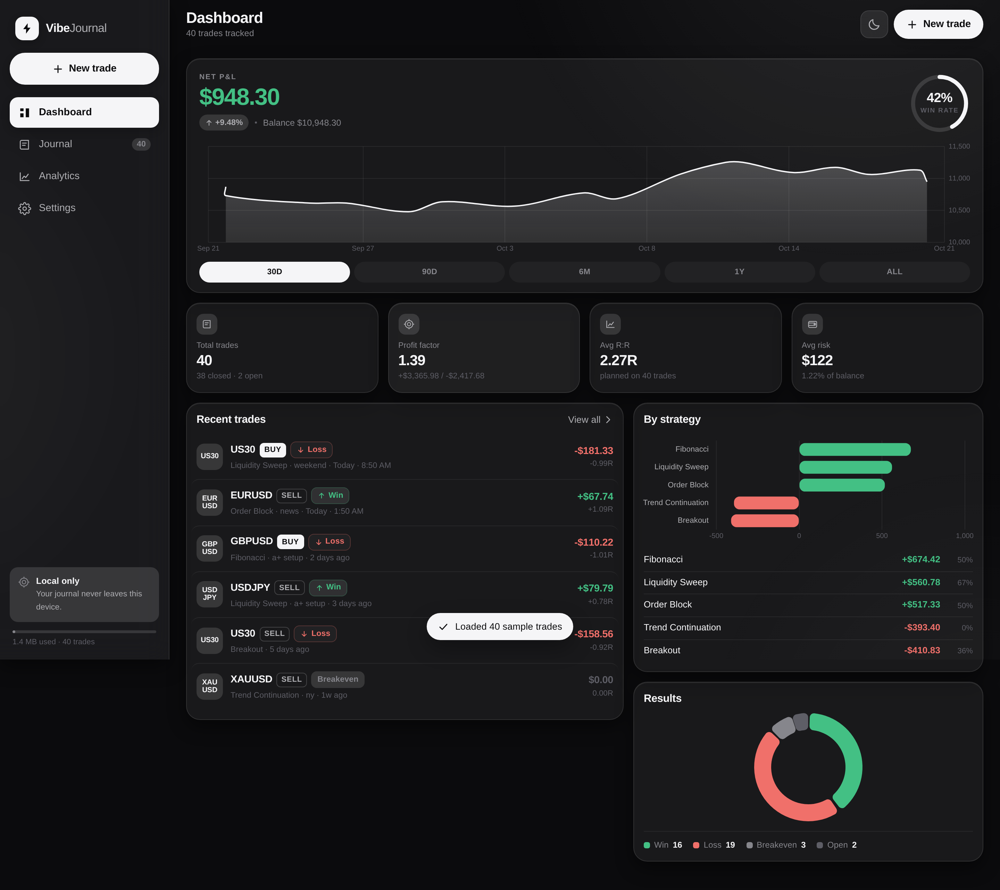
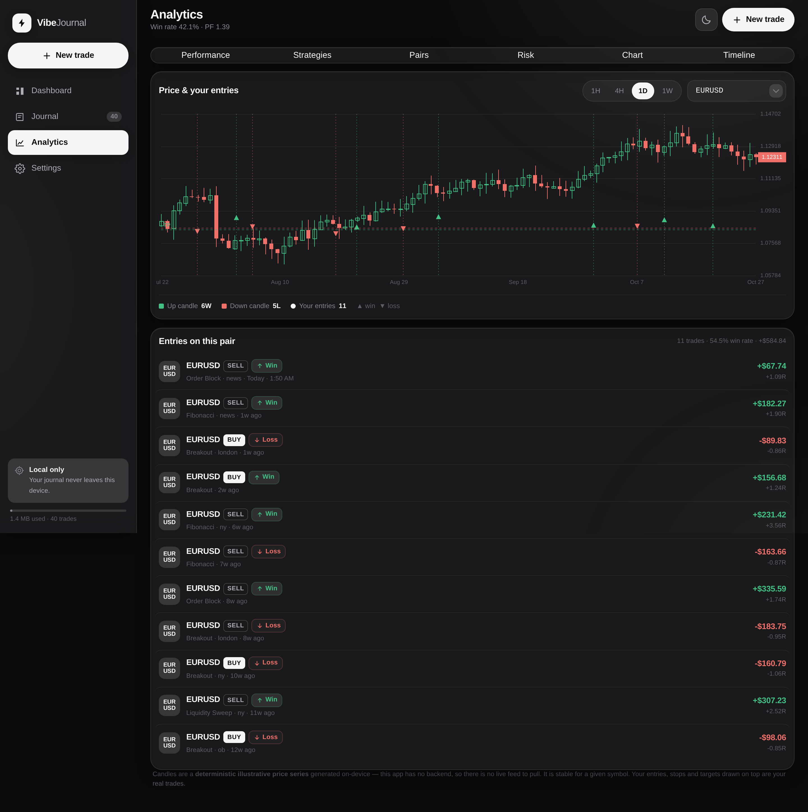
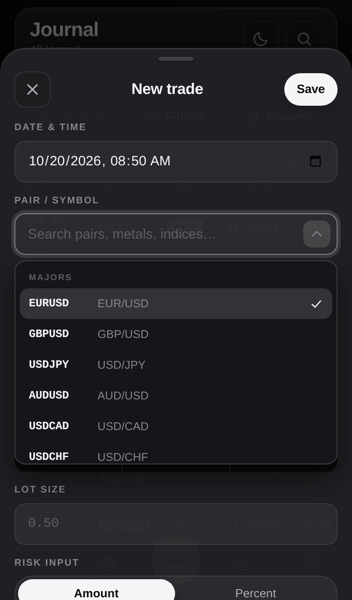

# VibeJournal

A private, installable **trading journal** that runs entirely in your browser.
No backend, no account, no telemetry — every trade you log stays in your
device's IndexedDB and is never transmitted anywhere.



---

## Features

**Trade logging** — date/time, pair, direction, entry, stop loss, take profit,
lot size, risk (amount *or* %), strategy, result, P&L, notes, custom tags and an
optional chart screenshot (stored as a compressed blob). Live R:R and pip
distance as you type; P&L auto-fills from risk × R:R when you mark a result.

**Dashboard** — net P&L, win-rate ring, equity curve over 30D/90D/6M/1Y/ALL,
profit factor, average R:R, average risk, recent trades and a per-strategy
breakdown.

**Journal** — full-text search across symbol, strategy, notes and tags, with
filters for date range, pair, strategy, result, direction and tags. Sortable
columns, one-tap edit and delete, and a full detail sheet per trade.

**Analytics** — performance (expectancy, average win/loss, best/worst, payoff
ratio, streaks), strategy and pair breakdowns, risk management stats
(average/largest/total risk, consistency, realised R), and a timeline with
monthly / weekly / day-of-week / hourly views.

**Candlestick chart** — real OHLC candles with *your* entries, stops and
targets plotted on the price series, plus 1H/4H/1D/1W timeframes. Also appears
in miniature inside each trade's detail sheet.



**Data** — JSON export (including screenshots as base64), CSV export,
JSON import, and a one-tap full wipe. Sample data generator for exploring the
app before committing your own trades.

## Install it

VibeJournal is a PWA. Serve the folder over HTTP and it will offer to install:

```bash
# any static server works
npx serve .
python3 -m http.server 8000
```

Then open it on your phone and use the browser's **Add to Home Screen** — it
launches fullscreen, works offline, and keeps your data between sessions.

> Service workers require HTTPS (or `localhost`). If you deploy to GitHub
> Pages, enable **Settings → Pages → Deploy from branch `main` / (root)**.

## Design

**"Frosted Ink"** — an iOS-style glass surface system: translucent panels over
a grayscale palette, hairline borders, soft shadows and generous whitespace.
Dark by default, with a full light theme and an optional semantic red/green
P&L mode.



## Performance

Rendering was profiled on an emulated iPhone 13 at 4× CPU throttling:

| | before | after |
|---|---|---|
| Scroll p95 frame | 42 ms | **19 ms** |
| Dropped frames (206) | 13 | **0** |
| Tab switch (click → painted) | ~300–500 ms | **47 ms avg** |

The wins came from removing live `backdrop-filter` from scrolling surfaces
(146 elements → 0 on mobile), replacing the blurred decorative blobs with
gradient layers, gating sticky `:hover` behind a real pointer, and skipping
chart rebuilds when the underlying data has not changed.

## Tech

Vanilla HTML, CSS and JavaScript — no build step, no framework, no runtime
dependencies. [Chart.js](https://www.chartjs.org/) 4.4.7 is vendored into
`vendor/` so the app is fully functional offline. Icons are generated by
`tools/make_icons.py` (Pillow).

```
index.html            app shell
css/style.css         design system + layout
js/db.js              IndexedDB layer
js/stats.js           analytics engine (pure functions)
js/instruments.js     instrument catalogue
js/picker.js          searchable combobox
js/candles.js         candlestick renderer
js/ui.js              formatting + chart theming
js/app.js             application
sw.js                 precaching service worker
```

## Tests

```bash
npm i -D playwright && npx playwright install chromium

node tools/serve.js &        # static server on :8099
node tools/verify.js         # static integrity sweep
node tools/e2e.js             # core app  (38 checks)
node tools/e2e2.js            # data, export, import  (18 checks)
node tools/e2e3.js            # picker, candles, colour  (35 checks)
node tools/perf-mobile.js     # mobile frame-time profile
```

## Privacy

There is no analytics, no tracking and no network call of any kind after the
app is cached. Your journal is stored under the `vibejournal` IndexedDB
database on your device. Clearing site data deletes it permanently — export a
backup first if you care about it.

## Licence

MIT — use it however you like.
